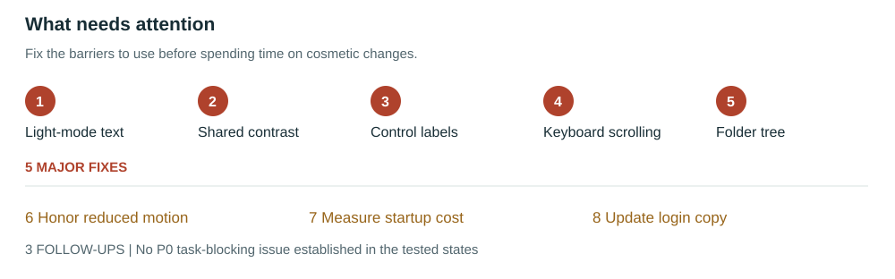
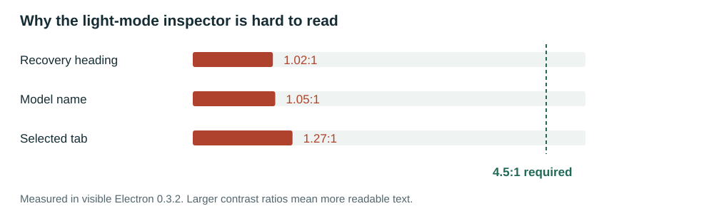

# Rasputin interface review

**Latest branch audit | October 28, 2026 | Fixes remain open**

[Read the illustrated PDF](RASPUTIN_UI_AUDIT_2026-10-28.pdf)

## The short version

The new home layout and shared menus work in the interactions tested. The Chat header is gone, the composer still works, and the inspected popups fit desktop, tablet, and phone widths. Those changes are worth keeping.

The next work should make the interface easier to read and use. The most serious example is in **Model Hub**: some light-mode headings almost disappear into their background. Several forms also have controls that a screen reader cannot identify properly.

**Assessment: 11/20. Eight grouped issues remain: five major fixes and three follow-ups.** This is a scoped technical assessment, not a release certificate. No task-blocking P0 issue was established in the tested states.

## Which code was audited

The newest local and fetched remote branch was **`codex/restore-rea-home`**, at **`44a251efe41e80e9d2c7ac54a7bec563271e1ebe`**. Its worktree was clean when inspected. Recent changes restore the REA home layout, remove the Chat header, rename navigation destinations, and unify menus and native select styling. The package reports version **0.3.2**.

The older checkout attached to this chat remains on `codex/unsloth-workstation-upgrade` with unrelated uncommitted changes. Those changes were not merged into the latest branch or silently treated as part of it. This report is published from that checkout, but the application being audited is the newer branch above.

The fresh source build and local 0.3.2 package have identical hashes for all **17 HTML, JavaScript, and CSS files** compared. Three visible packaged Electron states were checked through loopback-only DevTools, with disposable application data. The normal installed application and its real data were not changed. Packaged checks do not certify the installed application's current user state.

## What passed

| Check | Result | What it establishes |
| --- | --- | --- |
| Latest source production build | Passed | The current UI compiles; large-chunk and Pyodide warnings remain |
| Focused sidebar and shell tests | 11/11 passed | Source contracts and resize calculations hold |
| Current workstation browser suite | 12/12 passed | Tested menus, native selection, focus restoration, navigation, sidebar resizing, and welcome layout work |
| Additional route scans | 40 completed | Ten routes across dark desktop/tablet/phone and light desktop states |
| Additional popup scans | 15 completed | Five popup families stayed within tested widths and closed with Escape |
| Packaged Electron checks | 3 completed | Chat, Model Hub, and General Settings were checked in a visible 0.3.2 window |
| Page containment | No page overflow measured | Tested route states fit; a separate 320 px Chat check also fit |

Popup/model-selection tests used browser-side fixture models. They establish UI behavior, not model inference. Source route scans used a fresh data store and real login; packaged checks used Desktop's own local session.

## Fix first

### 1 Make Model Hub readable in light mode

**Priority P1 | Theming and accessibility | Still open from the previous audit**

The model inspector uses pale text intended for a dark background. When the panel becomes light, that text barely remains visible. The problem was confirmed in both the fresh source build and the visible Electron package.

| Text | Measured contrast | Required for this text |
| --- | --- | --- |
| Model name | 1.05:1 | 4.5:1 |
| Selected Overview tab | 1.27:1 | 4.5:1 |
| Recovery heading | 1.02:1 | 4.5:1 |

**Change:** Replace fixed pale foreground colors with theme-aware text colors. Check the model name, selected tabs, recovery messages, and connection actions together. This is a readability repair, not a reason to redesign Model Hub.

**Done when:** The affected text meets WCAG 1.4.3 contrast thresholds in both themes, with a selected model and an error state present. Verify in the rendered app; an empty panel cannot demonstrate the fix.

**Source:** `frontend-src/src/styles/models-workspace-v3.css:325`, `:334`, `:337`. **Next command:** `$impeccable harden`.

### 2 Give shared labels and buttons enough contrast

**Priority P1 | Accessibility | Still open, with updated measurements**

Small labels and several actions remain difficult to read. In the latest dark theme, “Local AI” measured **3.99:1**, “Runtime” **2.82:1**, and “Fix connection” **2.22:1**. The measured text requires 4.5:1. Light-mode shared text also fails, so an inspector-only fix would leave a wider problem behind.

**Change:** Correct the text/background pairs used by secondary labels, status text, and enabled actions. Repair the owning token or component rule so the improvement carries across pages. Review very small functional text as a readability concern; WCAG does not impose an absolute 11 px font minimum.

**Done when:** The named failures pass rendered contrast checks in both themes, including selected, hover, and focus states. Incomplete automated checks still need manual review.

**Source:** `components/shell/DashSidebar.jsx`, `styles/dashboard.css`, `styles/interface.css`, and `styles/theme.css` under `frontend-src/src/`. **Standard:** WCAG 1.4.3. **Next command:** `$impeccable harden`.

### 3 Make form controls say what they do

**Priority P1 | Accessibility | Confirmed again in the new branch**

A label can look correct while remaining disconnected from its field. That is what happens in several forms: a sighted reader sees “Interface Motion,” but assistive software receives an unnamed select control.

| Surface | What needs wiring |
| --- | --- |
| General Settings | Theme, language, and motion selects; Markdown and Testing Mode switches; visible workspace-path label |
| Skills | Session selector |
| Scheduled tasks | Interval and enabled controls; visible Name and Prompt labels |
| Discover models | Models-per-page selector once results appear |

**Change:** Connect labels to stable control IDs and give switches explicit names. Use clear names such as “Models per page.” Check both pagination implementations.

**Done when:** Every affected control can be found by its meaningful role and name, clicking its visible label activates the intended field, and values/checked states remain exposed. Settings behavior should stay the same.

**Source:** `GeneralSettings.jsx:85`, `:99`, `:114`, `:159`, `:172`; `SkillsView.jsx:16`; `SchedulesView.jsx:14`; `ModelsView.jsx:1121`. **Standards:** WCAG 4.1.2 and label relationships under 1.3.1. **Next command:** `$impeccable harden`.

### 4 Give clipped content a keyboard path

**Priority P1 | Accessibility and responsive behavior | Expanded coverage**

The Dashboard table can scroll sideways at narrow widths, but its wrapper has no explicit keyboard tab stop or focusable content. The fresh source-host audit also flagged the Discover detail column at tablet and phone widths. That column is conditional on the source-host mode; this is not a newly established Desktop-only regression. Keeping overflow inside a panel does not by itself make the hidden content reachable.

**Change:** Give scroll regions an appropriate accessible name, tab stop, and visible focus indicator. Inspect the Discover detail-column state before choosing its exact fix.

**Done when:** A keyboard user can reach the region, scroll to clipped content, and leave it normally. Test Dashboard horizontally and Discover's actual overflow direction. Preserve page containment and table semantics.

**Source:** `DashboardView.jsx:350`; `ModelsView.jsx:1413` and the matching `.models-v3-content > .w2-column:nth-child(2)` rendered region. **Standard:** WCAG 2.1.1. **Next command:** `$impeccable adapt`.

### 5 Put the Open Project action outside the folder tree

**Priority P1 | Accessibility and implementation integrity | Still open**

The approved-folders tree contains ordinary action-button content beside its tree items. That creates an invalid accessibility structure, confirmed at all tested route widths.

**Change:** Move Open Project outside the tree. Keep the action nearby and understandable. If the control is really a flat list of actions, use semantics that match that simpler behavior.

**Done when:** The tree has valid children, empty and populated states work, and keyboard selection/opening behavior remains intact. Preserve workspace permissions and folder approval behavior.

**Source:** `WorkspacesView.jsx:397` and its Open Project action around `:422`. **Standard:** WCAG 1.3.1 and ARIA tree structure. **Next command:** `$impeccable harden`.

## Then finish these three improvements

| ID and priority | Why it matters | Required change and completion check |
| --- | --- | --- |
| 6 P2 Respect reduced motion | A fresh profile uses full motion even when the OS requests reduced motion; Skills still pulses and rotates | Honor the OS when no explicit app override exists. Test OS reduce/full against absent, reduced, and full app preferences. Keep useful progress feedback. Source: `lib/motion.js:4`, `App.jsx`, `styles/interface.css`. Use `$impeccable animate`. |
| 7 P2 Measure startup cost | Vendor JavaScript is 936.65 kB, app JavaScript 455.53 kB, and main CSS 464.13 kB before compression | Measure cold launch, then defer costly secondary routes using the existing lazy-loading pattern. Compare startup timing and requested resources. Bundle size alone does not prove a slowdown. Source: `App.jsx` and `vite.config.mjs`. Use `$impeccable optimize`. |
| 8 P2 Update source-host login copy | The source login still advertises retired Docker deployment | Replace that claim with accurate native-runtime information and verify the rendered source login. Do not change authentication. Source: `features/auth/LoginShell.jsx:29`. Use `$impeccable clarify`. |

The motion finding is a preference-handling defect; it does not establish a blanket WCAG AA violation for all animation. The package's automatic-session flow differs from the source-host login.

## How the new work changes the previous assessment

The restored home layout and shared popup styling pass the interactions checked. In particular, the Options popup fits the 768 px viewport, native select changes work with mouse and keyboard, and the welcome screen retains its composer after removing the header. Those are concrete improvements.

The eight underlying issue groups remain open. The old report called the model-management page “Library”; **the latest navigation calls that destination Model Hub**, while Library now opens saved content at `#archive`. This report uses the new names.

| Audit dimension | Score | Reason |
| --- | --- | --- |
| Accessibility | 2/4 | Keyboard and focus support exist; naming, contrast, and structure gaps remain |
| Performance | 2/4 | Some routes are lazy; a large eager payload remains, without timing proof |
| Theming | 2/4 | Shared menus use tokens; Model Hub still assumes a dark background |
| Responsive design | 3/4 | Routes and popups fit tested widths; local scrolling and physical touch need further work |
| Implementation integrity | 2/4 | The product is recognizable, but repeated omissions and stale claims remain |
| **Total** | **11/20** | **Significant work needed; no overall score increase established** |

**Implementation integrity verdict:** The UI expresses a coherent workstation identity, but fails the audit's technical completion bar because confirmed gaps recur across surfaces. Decorative detector warnings alone do not determine that verdict.

## Evidence that should not be overread

The Electron detector completed three CDP scans with exit 2, meaning findings were returned. It produced 12, 37, and 36 raw matches on Chat, Model Hub, and General Settings. Some matches reference hidden, mounted views or stylistic patterns. These are not 85 separate user-facing defects. Contrast findings above were independently checked in the visible UI with axe and screenshots.

The Google publisher gradient is branding, accent borders can express state, and a cream palette is not a technical defect. Do not remove these wholesale. Small controls require spacing/exception checks before being called target-size violations. A skipped heading or undersized text flag also needs context.

The browser suite initially failed during collection because the audit harness loaded the runner from the wrong checkout; the correct worktree-local runner subsequently passed all 12 tests. The first Electron harness expected `127.0.0.1` and rejected the valid `localhost` URL; the corrected run completed all three checks. These were harness errors, not application regressions.

Still unverified: physical touch, full screen-reader output, every theme, every modal/state, real-model inference, installed-user-state behavior, frame rate, and cold-launch timing. The 40 route scans sampled rendered states while catalog data arrived asynchronously. Popup tests used fixture models and did not start inference.

## Recommended order

1. Run `$impeccable harden` for contrast, control names, and Workspace semantics.
2. Run `$impeccable adapt` for keyboard access to scroll regions.
3. Run `$impeccable animate`, `$impeccable clarify`, and measured `$impeccable optimize` work.
4. Finish with `$impeccable polish`, then repeat `$impeccable audit` against the repaired source and package.

You can ask me to run these one at a time, all at once, or in any order you prefer. None of the fixes was implemented as part of this audit. The [previous fix report](RASPUTIN_UI_REMEDIATION_REPORT_2026-10-27.md) remains a dated record of the earlier branch.

**TL;DR:** Keep the restored home and menu work. Fix Model Hub readability, control labels, keyboard scrolling, and folder-tree semantics next. The new package works in the tested flows, but those accessibility defects are still present.
