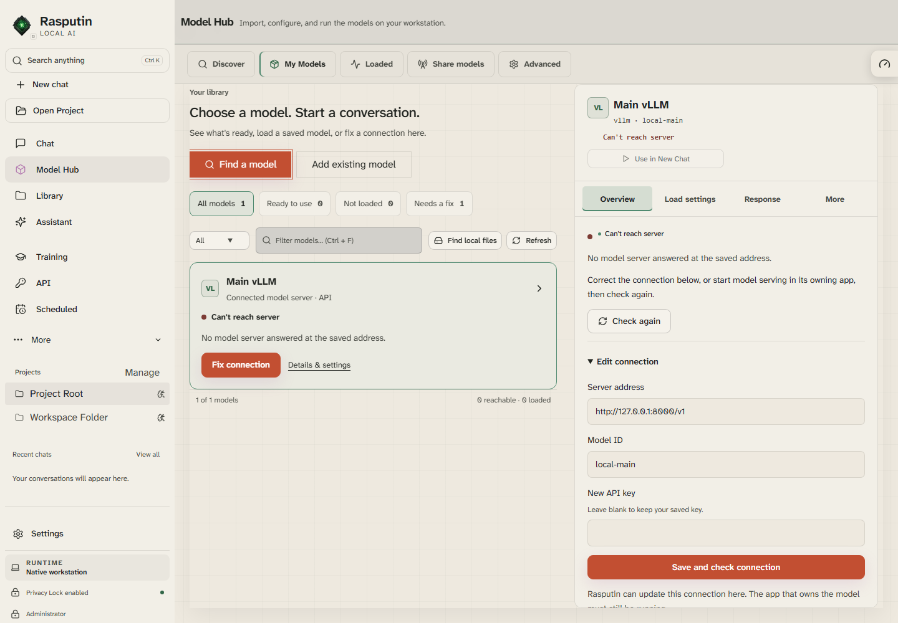

# Rasputin UI audit fixes

**October 28, 2026 · Source implementation and browser verification**

The eight issue groups in the illustrated October 28 audit are implemented. Model Hub text now follows the theme, controls expose useful names, clipped panels work with a keyboard, motion can follow the operating system, and secondary pages load on demand.

This work starts from the audited `codex/restore-rea-home` commit `44a251efe41e80e9d2c7ac54a7bec563271e1ebe`. The changes live on `codex/ui-audit-remediation`. The older chat checkout and its unrelated edits were left alone.

## What changed

| Audit issue | Result |
| --- | --- |
| 1. Model Hub disappears in light mode | Inspector names, selected tabs, recovery headings, status text, and native option colors use theme tokens. A selected, unreachable model was checked with its recovery controls visible. |
| 2. Labels and actions have weak contrast | Shared secondary/status colors are readable in both house themes. Primary actions choose black or white text from the accent's measured luminance. A button reset now lives in the base cascade layer so it cannot override utility colors. Bootstrap primary buttons share the same foreground pairing. Workspace and Settings surfaces retain readable foregrounds. |
| 3. Controls lack useful names | General Settings, Skills, Schedules, and both Model Hub pagination implementations have connected labels or explicit accessible names. Clicking the Markdown label toggles its switch. |
| 4. Clipped content is difficult to reach | Dashboard's horizontal table and Native Host Discover's detail column have named, focusable regions with visible focus. Arrow keys scroll them, and Tab leaves normally. |
| 5. Open Project sits inside a tree | The action and empty-state message sit beside the approved-folders tree. An empty list no longer exposes an empty tree. Folder selection and approval handlers remain in place. |
| 6. Fresh profiles ignore reduced motion | The default is **Follow system preference**. OS changes apply immediately; explicit Full or Reduced choices survive reload. The preference stores the choice rather than overwriting it with the resolved OS value. Skills' decorative pulse and rotation stop under Reduced motion. |
| 7. Startup cost is unmeasured | Dashboard, Model Hub, Workspaces, and Settings defer their first mount. Visited pages remain mounted to preserve filters and drafts. Loading feedback and a reload action cover failed page downloads. The vendor bucket no longer forces chart-only dependencies into startup. Measurements are below. |
| 8. Login advertises retired deployment | Native Host login now describes local accounts. Authentication behavior is unchanged. |

## The visible result



This is the built source UI in an isolated Native Host session. It demonstrates the selected model and error state; it does not demonstrate inference or an installed-app update.

## Verification

| Check | Result | Boundary |
| --- | --- | --- |
| Production build: `npm.cmd run build` | Passed | Existing Pyodide browser-externalization and large-chunk warnings remain. |
| Focused Node tests | 31 passed | Motion resolution, theme palette pairing, sidebar sizing, shell, Model Hub, and Settings contracts. |
| Backend smoke: `.venv\Scripts\python.exe -m unittest tests.testBackendSmoke` | 168 passed | Includes saving and reading the System motion preference. |
| Browser tests: `studioChrome.spec.mjs` and `uiAuditRemediation.spec.mjs` | 18 passed | Real authentication against disposable data; the existing desktop-shell suite uses browser fixtures for Desktop mode and model menus. |
| axe-core 4.10.3 route scans | 48 states, zero detected violations | WCAG A/AA tags through 2.2; no page-level horizontal overflow in sampled states. Automated scans are not full accessibility certification. |
| Native Host login scan | Zero detected violations | Local-account copy was rendered before authentication. |

The route matrix covers Chat, Model Hub, Library, General Settings, Workspaces, Dashboard, Activity, Skills, Schedules, and Discover at dark desktop (1440), tablet (768), and phone (390) widths, plus light desktop. API and Training were checked in both house themes at desktop width. Light phone checks cover Chat, Model Hub, General Settings, and Workspaces. Primary action contrast is tested in normal, hover, and focus states; Workspace hover states receive additional scans.

The new browser regressions also exercise saved motion overrides, actual reduced-motion animation styles, keyboard scrolling, preserved model filters after navigation, and a deliberately failed Settings download. A failed download shows a recovery action while Chat remains reachable.

Run the focused source checks with:

```powershell
node --test tests/motionPreference.test.mjs tests/sidebarSizing.test.mjs tests/desktopMinimalShell.test.mjs tests/themeCatalog.test.mjs tests/modelsWorkspaceV3.test.mjs tests/settingsWorkspaceV3.test.mjs
```

For browser tests, start an isolated authenticated server using the repository's verification skill, set `RASPUTIN_TEST_BASE_URL` and `RASPUTIN_TEST_PASSWORD` for that disposable session, then run:

```powershell
npx.cmd playwright test tests/ui/studioChrome.spec.mjs tests/ui/uiAuditRemediation.spec.mjs --config playwright.config.mjs
```

## Startup measurement

Seven fresh-cache Chromium contexts per comparison opened authenticated Chat at 1440 × 1000 against an isolated local backend. The timing ends when the application is ready and the composer is visible. It includes navigation and UI initialization; it excludes login and full Electron process launch.

| Measure | Audited build | Remediated build |
| --- | ---: | ---: |
| Initial Chat JavaScript requested, decoded bytes | 1,753,519 | 1,218,499 |
| Median navigation-to-ready, final seven-trial run | 842 ms | 582 ms |

The stable resource improvement is **535,020 fewer JavaScript bytes, about 30.5%**. An earlier remediated seven-trial run measured 756 ms, so timing varies with machine and process warm-up. These runs support reduced startup work; they do not establish a fixed launch-speed guarantee. Chart and settings code still incur a first-visit load, and some shared model code remains in the initial dependency graph.

The [verification receipt](evidence/ui-audit-fixes-2026-10-28.json) records the sampled states, scan results, and raw timing/resource measurements without credentials or local data paths.

## Delivery and rollback

This branch contains source changes and regression tests. It does **not** rebuild an installer, replace the installed application, publish a release, or certify installed-user-state behavior. Screen-reader output, physical touch, every alternate theme/modal, real-model inference, and full Electron cold launch remain outside this verification.

To roll back, revert the scoped remediation commit. The lazy-loading change is localized to `App.jsx`, `DeferredView.jsx`, and the Vite chunk policy; the existing route components retain their behavior after mounting.

**TL;DR:** All eight audit groups are addressed in source. Tests and sampled accessibility checks pass. The installed app still needs a separate build and installation verification.
