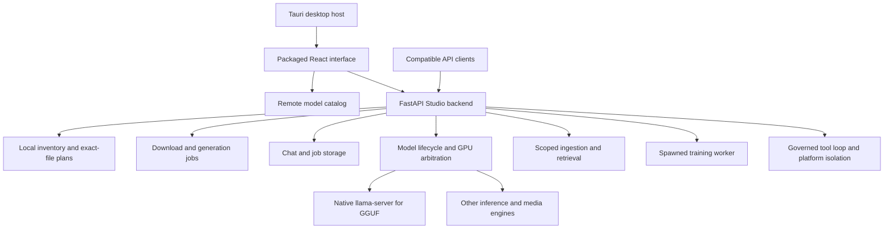
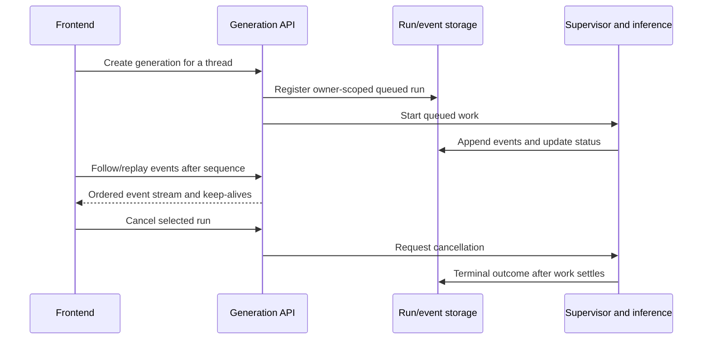

# Unsloth application reverse-engineering study

**Study date:** October 26, 2026

**Target:** installed Unsloth Desktop `0.1.911-beta`, its packaged frontend, and the readable Studio backend shipped alongside it.

**Purpose:** establish how Unsloth works. This is a reconstruction of the application, not a Rasputin implementation plan.

## 1. Findings and evidence boundary

Unsloth is a desktop host around a web interface and a shared Python service. Its model experience is built from several distinct systems: remote discovery, federated local inventory, exact-file planning, background downloads, load admission, native engine management, and compatible inference APIs. Chat, tools, knowledge, training, and media build on that service layer and have their own job and resource lifecycles.

The most consequential distinction is between **a model repository**, **a concrete local artifact**, and **a resident inference engine**. A repository may offer several quantizations, split files, projectors, and other companions. Finding a repository is not downloading a complete artifact; finding files is not proving they can load; selecting a model is not observing a healthy engine.

Evidence has three levels throughout this study:

| Label | Meaning |
| --- | --- |
| **Observed: artifact** | File identity, metadata, imports, packaged assets, and REA static results from the installed application. |
| **Observed: code** | A mechanism or branch present in the installed Python code or packaged JavaScript. This does not establish successful execution. |
| **Inference / unknown** | A relationship suggested by the observations, or behavior that needs a live run or deeper native analysis. |

No live download, model load, chat response, tool execution, RAG query, training run, or media generation was tested. Desktop observation timed out at app-access approval. The report therefore explains the implemented contracts and their limits without claiming an end-to-end runtime certification.

### Target identity

| Artifact | Recorded identity |
| --- | --- |
| Desktop executable | `unsloth-studio.exe`, `0.1.911-beta`, 38,833,984 bytes |
| Executable SHA-256 | `c4ecb646ae2c9d2e8d31b92baf94b4c957ac38f03ba68595aa6002622ed7c27a` |
| Packaged frontend inventory SHA-256 | `3b88819dec802b0a7349419b0c43379fb405f5fca82acfff6385a7d48b621a95` |
| Analysis tool | REA CLI `6.8.0`, using an existing Node `24.22.1` runtime |
| Studio package root used for citations | `<installation>/studio/unsloth_studio/Lib/site-packages/studio/` |

The frontend inventory digest is REA's reconstructed directory identity, not the hash of one JavaScript file. The executable version does not prove that every separately stored backend file was built from the same source commit. No upstream-commit equivalence or signature verification was established.

The [provenance index](evidence/unsloth-2026-10-26.json) records source hashes, line ranges, REA Evidence IDs, selected scopes, and analysis limits. Source keys such as **S07** below resolve to that index and the source table in section 14. Machine-specific paths, user databases, logs, credentials, model weights, and copied upstream implementation code are excluded from the committed study.

## 2. Application structure

**Observed: artifact/code.** The installed root manifest identifies a Tauri CLI lockfile holder, pinned to `@tauri-apps/cli` `2.10.1`. It is not the frontend dependency manifest. The frontend has its own manifest declaring React `19.2.4`, TanStack Router, Tailwind, Tauri APIs, and other UI dependencies. The installed frontend includes built, hashed JavaScript chunks rather than its complete original `src` tree. [S01]

The Python backend creates a FastAPI application. It registers separate route families for models, inference, chat history, training, Hub/downloads, RAG, MCP, skills, scheduled tasks, data recipes, media engines, and browser functions. Some inference routes are exposed both under Studio's `/api/inference` prefix and the compatibility prefix `/v1`. [S01]

The following diagram is a reconstruction of those code boundaries, not a runtime trace:



### Desktop connection and authentication

The packaged API-base helper detects Tauri globals or the `tauri:` protocol. In that environment it begins with a loopback placeholder and provides a setter for the actual backend port. Browser mode can use relative API paths. A separate packaged helper invokes a Tauri command named `desktop_auth`, handles a `login_required` result, and can store an issued access/refresh session or direct the UI to login/password-change routes. [S02]

This establishes a desktop/backend handshake in the frontend code. It does **not** establish that the native host always authenticates automatically, that all routes use the same authorization model, or that its backend is safe to expose beyond loopback. Native host process ownership, update validation, and exact backend startup/teardown were not reconstructed from native functions in this pass.

## 3. Model Hub: browsing and selection

### What the interface actually represents

**Observed: packaged code.** The relevant model-browser chunk is `hub-page-CnkUbzTL.js`. The similarly named `library-page-DzKt5R_C.js` is a different application area and must not be treated as the model Hub.

The Hub bundle contains distinct Discover/On Device views, name/repository search, sorting and resource/format/capability filters, model selection, details, exact variants, and README presentation. Its own guided-tour text describes Discover as browsing Hugging Face and On Device as showing local downloads and fine-tunes with disk usage. These are code-present UI contracts; the installed window was not observed executing them. [S03]

The split list/detail layout is functional state, not just styling. The bundle stores the list width in local storage; the separator has drag handling, keyboard handling, an accessible current/minimum/maximum value, and double-click reset. The selected Hub tab is synchronized with the `/hub` route's search state. [S03]

### Discovery transport

**Observed: packaged code.** The default Discover search path is a browser-side model-list request, not necessarily a Studio `/api/hub/search` endpoint. The Hub calls a shared search helper that constructs a catalog request ending in `/api/models`, with query fields including `limit`, `author`, `pipeline_tag`, `search`, `filter`, and `expand`. The iterator follows Link-header pagination. The packaged default catalog endpoint is `https://huggingface.co`; endpoint/proxy and ModelScope-related code can change that route. [S17]

Consequently, inspecting only the backend Hub routes misses part of discovery. The actual configured catalog host, authentication behavior, network result order, pagination latency, and offline behavior of a running session remain unobserved.

The reconstructed search chain is:

```text
Hub Discover hook (debounced query and current filters)
  -> search/channel dispatcher
  -> paginated model-list iterator
  -> request wrapper and AbortController
  -> browser fetch to the configured catalog endpoint
  -> record normalization and post-fetch filters
  -> merge with local/downloaded model information
  -> visible result rows
```

The request helper adds parameter-count bounds, sort direction, and `expand=gguf`, with a 15-second request timeout. Some filters require additional metadata: missing context information can cause a `resolve/main/config.json` fetch, and organization classification can cause an `/api/organizations/{owner}/overview` request. Those inspections run in batches of four. Unknown dimensions do not automatically satisfy an explicit requested bound. [S17]

### Ranking, caches, and offline states

The default empty-query uploader scope is Unsloth. General search can prioritize Unsloth results and an exact repository before yielding deduplicated wider results. The code defines trending, latest, and fine-tunable channels with different author/format/sort settings. This is application-side ranking and filtering over remote catalog results, not proof of a locally bundled immutable model catalog. [S17]

| Cache | Observed policy |
| --- | --- |
| Feed cache | Persisted `unsloth.studio.hubFeed`, schema version 1; first 24 records per channel; identity includes endpoint and token fingerprint. |
| Feed expiry | Trending 30 minutes, latest 5 minutes, fine-tune 30 minutes. The inspected active background-fetch list contains the trending channel. |
| Selected repository details | Five-minute TTL, 256 entries, concurrency three, and in-flight deduplication. Private/gated records are not freely shared through an anonymous cache identity. |
| Raw README | 64 entries; missing-card cache five minutes; transient errors 30 seconds. |
| Prepared README | 60-second TTL; rendered source text is capped at 120,000 characters with a truncation notice. |

A matching unexpired feed can substitute when there are no active filters and current results are empty. That limited fallback does not establish that arbitrary searches work offline. Selected-detail fetching is separately enabled by selection and online state. Its model metadata request uses `/api/models/{name}/revision/{revision-or-HEAD}` with expanded fields. [S17]

The bundle distinguishes offline, token rejection, rate-limit/server, and generic network failures. Retry and On Device are explicit recovery paths; ModelScope is offered where eligible. Background fetching owns cancellation controllers and uses backoff/jitter. The exact network/error sequence on the installed workstation remains unknown. [S17]

### Details and README

The Hub's README path tries `main` and `master` under a model's resolve URL. It also contains relative-link resolution and link/media handling. Model detail and local-file operations cross into Studio API helpers: for example, the shared frontend model helper calls `/api/models/gguf-variants`, while the backend also has Hub inventory/download surfaces. These route families overlap; a route's existence alone does not prove the current Hub uses it for every operation. [S03, S04]

README requests have a ten-second timeout. Two branch-level 404 responses mean no card; other failed outcomes are treated as fetch errors. Offline without cached prepared content, the UI has an explicit unavailable state. Preparation retains the resolved branch as the base for relative resources, and Markdown handling includes dangerous-protocol rejection and offline treatment of external links. These are inspected paths, not a complete Markdown security assessment. [S17]

## 4. Model identity and exact-file planning

**Observed: code.** `GgufVariantDetail` is richer than a quantization label. It carries the concrete filename, quantization, cache/source information, main-file bytes, full download bytes, companions still required, remaining bytes, downloaded/update status, partial-download state, transport, and whether a partial is resumable. [S05]

`GgufVariantPlan` separates main files from the full target file set and tracks expected files, hashes, vision projectors, and companion requirements. Planning includes coherent shard-family selection. This avoids treating all similarly named quantized files as the same downloadable object. [S05]

The resulting conceptual chain is:

```text
Repository
  -> selected variant / shard family
  -> main weights + required companions + expected-file manifest
  -> complete local artifact
  -> load request with explicit settings
  -> healthy resident runtime
```

This explains why a row can be locally present but still incomplete, or why the download size can exceed the size of the main weight file. It also explains why capabilities and runtime support cannot be derived reliably from the display name alone.

## 5. On Device inventory

**Observed: code.** Local inventory aggregates multiple sources, including Hugging Face caches, LM Studio, Ollama, other recognized model directories, and custom scan folders. Source records preserve source type, path/format information, completeness, and capabilities. Visibility does not imply that the app owns the file, can delete it, can train it, or can run it through every engine. [S05, S06]

Custom scanning is bounded: the inspected code declares limits of 200 models per custom folder, 2,000 entries, and a 200-entry model-signal probe. Inventory also has in-flight request coordination, cache invalidation, and bounded retry when the underlying cache changes during a scan. [S06]

The backend exposes local inventory, scan-folder management, and model-folder information. The packaged frontend also uses `/api/models/local`, cached-model paths, recommended folders, and reveal operations. A model browser therefore joins several inventories rather than merely listing one application-managed download directory. [S04, S06]

**Unknown:** actual custom folders, installed model counts, local duplication, inventory scan duration, and whether each external cache works on this workstation. No user library contents were inspected.

## 6. Download manager

### Request, ownership, and state

**Observed: code.** Hub download requests return HTTP 202 and are represented as backend-owned jobs. Requests can identify a repository, exact GGUF variant, transport preference (`auto`, `xet`, or `http`), scoped file set, and destination. Status distinguishes idle/running/completed/error and cancellation stages. [S07]

A normalized repository-plus-variant key identifies a transfer. Additional fields solve two different race problems:

| Field | Role |
| --- | --- |
| `generation` | Identifies a particular run, so a cancellation intended for an old run need not cancel its replacement. |
| `attempt` | Distinguishes retries and lets consumers discard stale progress. |
| `attached` | Indicates adoption of an existing matching transfer instead of creating a duplicate. |

Download admission validates the request and resolves ownership/scope. A competing request with a mismatched exact file set can receive HTTP 409. Cancellation has its own endpoint and cancellation state; a cancel request is not itself proof that the worker has exited. [S07]

### Transport and partial files

Automatic transport selection considers host RAM, `hf_xet` availability, and prior failures. The lifecycle can retry a stalled transport or fall back to HTTP while preserving the job's intended ownership and cancellation semantics. [S07]

The HTTP worker describes sequential writing, an active `.incomplete` file, compatible append-mode reuse, and cleanup of unsafe partials. Some partials are not byte-resumable with the installed writer. Thus a partial-download indicator, a retry, and byte-resume are separate guarantees. [S07]

### What completion verifies

The inspected `_verify_completed_download` checks expected files against the manifest and reports missing files or size mismatches. Crucially, **when no manifest exists, this final check returns without verification and relies on the downloader's exit status**. Other paths have expected hashes and reusable-file hashing, but that does not prove a universal full-file SHA-256 check after every successful transfer. [S07]

The evidence supports the following distinctions:

1. The downloader exited successfully.
2. Expected files exist and match declared sizes.
3. Content hashes were checked on a particular path.
4. The resulting model actually loaded and produced valid inference.

These are not interchangeable success criteria. Persistence and recovery of every download state across a backend restart were not tested.

## 7. Memory estimation, load admission, and engine lifecycle

### Estimating a selected configuration

**Observed: code.** `/api/inference/estimate-memory` uses locally available GGUF metadata/file sizes and loader estimates for KV cache, compute buffers, and companions. It does not need to load tensors or download a missing model to perform that estimate. It can return reasons such as unsupported source, not downloaded, unsizable, or not GGUF. Missing dimensions leave the KV estimate unavailable instead of inventing a reliable total. [S08]

Memory fit depends on the selected artifact and settings: context length, parallel slots, cache type, companions, devices, and placement mode. The load schema treats context `0` as automatic and distinguishes a previously fitted context from an explicit user choice. Requested settings and effective runner settings therefore have different meanings. [S08]

### Loading and readiness

The load route enters a gated lifecycle, including resource-arbiter logic. GGUF loading uses native `llama-server`; the request can carry a load-request identity. Load progress exposes mapping/upload phases, byte progress, throughput, and ETA, rather than only a boolean loading flag. [S08]

The native engine code polls `/health` while checking process exit, cancellation, stalls, and a ceiling. A spawned process is not automatically a ready model. The reconstructed progression is:

```text
load requested
  -> admission/resource decision
  -> native process startup and model mapping/upload
  -> health readiness
  -> resident model available for inference
```

Failures, cancellation, and cleanup can interrupt that progression. The inspected unload path signals cancellation, terminates its process, clears fallback runtime state, and clears loaded identity. The unload route also considers active generations and resident ownership; a deliberately unloaded model should not be resurrected by an old idle-reload stash. [S08]

### Shared GPU resources

Unsloth has a GPU arbiter with acquire/release paths and decisions about existing owners and evictions. Training, text inference, and media cannot be understood as independent buttons that always fit simultaneously. Source shows explicit admission checks and resource handover, but successful concurrent behavior, eviction timing, and actual free-memory measurements were not verified here. [S08, S13, S15]

## 8. Chat generation and transport

**Observed: code.** Chat generation has a durable run record, separate from the browser's live stream. Creating a run stores owner/thread/message identity and a sanitized request. Creation is coordinated with model lifecycle so a run is not registered halfway through a model swap. A supervisor starts queued work. [S09]

The storage schema declares queued/running/cancelling states and terminal cancelled/completed/failed outcomes. Routes expose active runs, lookup, cancellation, and events. Events have sequence, type, payload, and creation time; followers can request replay after an event sequence or with `Last-Event-ID`. Heartbeats and keep-alives have their own handling. [S09]



This is a code reconstruction, not a captured request trace. Follower and unattended-stop policies mean “the browser disconnected” should not be equated with either “always cancel” or “always keep running.” Startup code reconciles orphaned runs. That supports recovery bookkeeping; it does not prove that in-flight inference resumes after the backend process dies. [S09]

## 9. Tools, approvals, MCP, and isolation

**Observed: code.** The Studio tool loop is deliberately separated from provider transport. The loop owns repeated model turns, budgets, approval decisions, execution, and replay. Transport adapters supply normalized streaming responses. Some malformed text-form tool calls are handled through a bounded suspected-call buffer; invalid content can be returned as text rather than blindly executed. [S10]

For a prospective tool call, the inspected sequence is:

1. Classify the call against permission and risk policy.
2. Decide whether confirmation and OS isolation are required.
3. If needed, allocate an approval slot and emit a waiting state.
4. Keep the stream alive while waiting for a decision.
5. Continue according to the decision and execution result.

Image sharing explicitly requires confirmation in the inspected loop. Conversely, permission/bypass settings can affect other calls. Source does **not** justify describing every Unsloth action as always confirmed or always sandboxed. [S10]

Platform isolation has explicit capability checks. The Windows route delegates to an MXC process-container backend and can report unavailable. Software safeguards at a lower isolation level are distinct from OS isolation. No Windows containment test, escape analysis, or certification was performed.

One useful backend boundary is explicit: a request that needs confirmation-enabled local execution can be rejected if its transport lacks a streaming event channel capable of carrying that interaction. Approval presentation is therefore part of the request contract, not just a frontend preference. [S10]

The application also registers MCP and skills surfaces. Route presence establishes product structure, not that every installed server, tool, or skill works safely or supports every model. This pass is a reconstruction, not a security audit.

## 10. Conversations, projects, files, and knowledge

### Chat and project records

**Observed: code.** Thread records include model identity, exact GGUF variant, project linkage, and archive state. Per-thread settings are modeled separately. Projects have instructions, folder-related metadata, and archival state. [S11]

The ordinary saved project record does not simply trust a client to rewrite the working folder: native folder selection uses a `nativePathLease`. This is a concrete distinction between remembering a folder label and authorizing a native filesystem selection. The lifetime and enforcement of every lease path were not exhaustively audited. [S11]

### RAG ingestion

The ingestion code follows parse → chunk → embed → store. It returns document/job identities, uses background workers and progress events, and performs per-scope content-hash deduplication. Renewable leases check whether the owning account/folder still exists while work proceeds. [S12]

Knowledge can be scoped to a knowledge base, thread, or project. Scope-owner checks and linked-folder path-lease validation appear in the route layer. User-facing attachment, project knowledge, and native folders are related concepts with separate identities and access paths. [S12]

### Retrieval

The inspected retrieval implementation combines SQLite FTS5 lexical search and dense cosine retrieval through `vec0`, using reciprocal-rank fusion. It supports lexical, dense, and hybrid modes. Embedding identity is tracked, including warnings for older untagged vectors. [S12]

This establishes the retrieval mechanism. It does not establish retrieval quality, default results for a particular project, index freshness on this workstation, or the reliability of answer citations after generation. No private knowledge store was opened.

## 11. Training, Data Designer, and media

### Training workers

**Observed: code.** Training launches a fresh subprocess using the multiprocessing `spawn` context. The source explains that fresh workers support switching Transformers environments/versions. The training API has separate preview/preflight, start acknowledgment, start/stop/reset, status, metrics, and progress paths. Resume provenance is also treated explicitly. [S13]

Training is a separate resource-intensive lifecycle, not ordinary inference with another prompt. Source includes platform/preflight checks and exclusions between inference, diffusion training, and LLM training. No training worker was launched, and no result quality or resume correctness was measured. [S13]

### Data Designer

Recipe jobs distinguish preview from full generation. The backend validates column definitions and names, resolves providers/models, constrains local-command/host-environment credential use, and exposes status/current/cancel and dataset/export paths. Download-link preparation checks readiness and format before the native save interaction. [S14]

The code therefore describes a pipeline of recipe validation → asynchronous generation → inspectable dataset → export, with a smaller preview path. Actual generated rows, token costs, provider compatibility, and cancellation behavior were not tested.

### Video and voice

Video has its own plan/download/load/load-progress/generate/progress/cancel/status/unload/gallery API family. Long generation returns promptly and continues as background work with progress and a terminal outcome. The route validates supported target families before eviction/loading and coordinates with the GPU arbiter. [S15]

Dictation uses a speech-to-text sidecar alongside the chat model. Its source explicitly avoids treating dictation as a reason to evict the text model, validates input size/encoding, and handles disconnect cancellation. This is different from making the selected language model itself understand audio. [S15]

Image, audio, and video route/engine registration was identified, but their complete codecs, model-family matrices, hardware support, and gallery/export implementations were not reconstructed exhaustively.

## 12. External inference APIs

**Observed: code.** The application exposes model listing, chat completions, text completions, embeddings, Responses, and Anthropic-style messages under the inference route layer. These are separate protocol surfaces over the application's model/runtime systems. [S01, S16]

The `/v1/models` implementation documents loaded models **and locally downloaded/cached models**, with clean public IDs and a `loaded` flag. It supports quant-specific IDs and avoids borrowing a resident quantization's context fields when describing another quantization. Thus an advertised model and a currently resident model are intentionally different states. [S16]

Finding these routes does not prove full protocol conformance, compatibility with every external client, automatic loading policy on every path, or successful tool calling for every served model. No compatibility client was connected during this study.

## 13. Coverage and unresolved questions

| Question | Status | What is established / what remains |
| --- | --- | --- |
| What installed product was selected? | **Answered: identity** | Executable version, size, SHA-256, and associated packaged frontend inventory recorded. Same-commit parity across all components is unknown. |
| How is the app divided into systems? | **Answered: static architecture** | Tauri-related shell metadata, packaged React UI, FastAPI routes, storage/jobs, native and other engines. Native bootstrap internals remain unexamined. |
| How does Discover search and show details? | **Answered: static path** | Browser catalog request, Link pagination, configurable endpoint, Hub selection/details/README code. Live endpoint and result behavior unknown. |
| How are local files and variants represented? | **Answered: code** | Federated sources, completeness/capability fields, shard/companion plans. Actual library contents intentionally unexamined. |
| How do downloads/cancel/resume work? | **Answered: code; runtime open** | Job/run/attempt identity, transport selection, partial-file handling, qualified completion verification. No restart/cancel race or byte-resume test. |
| How are fit and readiness determined? | **Answered: code; runtime open** | Parameter-sensitive estimates, unknown states, load gates/progress/health checks and arbiter. No actual fit measurement or engine launch. |
| How do chat streams and cancellation work? | **Answered: code; runtime open** | Persistent run/events, replay sequences, followers, supervisor and cancellation state. No reconnect/restart scenario executed. |
| How are tools and knowledge governed? | **Partial** | Approval/isolation branches, project folder leases, scoped ingestion/retrieval. No security audit or containment test. |
| How do training/data/media workflows work? | **Partial** | Worker/job/resource architecture and selected route contracts. No execution or exhaustive model-family coverage. |
| Is the native UI accessible, responsive, and faithful to the bundled code? | **Unverified** | App-access approval timed out; no installed-window interaction proof. |
| Does the native executable's code implement the inferred desktop lifecycle? | **Unverified** | Import inspection is complete; native function decompilation was not performed. |

### REA results and limitations

- **Completed:** executable PE import inspection, Evidence `ev_e0c4197c1d597a7af80c0f6eb392f85e773727a22ba5e4e36dbfe199c4f4a51d`. Imports are static table observations; they do not prove reachable or executed calls.
- **Completed in selected scope:** API-base/API-helper JavaScript analysis, parent Evidence `ev_a347f343449010400f2260c3fd67595ebf982473fd6750194c23eb612cd6b020`. Two selected files, 16,237 text bytes, 4,293 visited AST nodes, no parse failures; 721 other inventoried files were outside that selected analysis. A completed command is not complete application coverage.
- **Partial:** the initial five-file frontend analysis, Evidence `ev_8b629112541b5554408e4923a574392f98ab75b9fe0beac4ff0675878c631a1c`, hit a 300,000 ms per-source provider timeout on `assets/index-B_wuJfvl.js`. One JavaScript file was parsed; four selected files were skipped. Partial evidence was retained rather than presented as a successful full reconstruction.
- **Manual static follow-up:** Hub and model helpers were read as inert packaged text, with source hashes and byte anchors. The generic REA graph did not establish those UI execution paths. Minified dynamic expressions and name collisions can produce ambiguous inferred relationships.
- **Not performed:** live runtime capture, native disassembly/decompilation, signature trust verification, protocol conformance testing, performance measurement, security validation, model execution, or user-data inspection.

### Remaining investigation work

The highest-value unresolved evidence is an installed-app runtime trace of Discover → model detail → exact file → completed download → load progress → health-ready → generation → stop, together with reconnect/cancel/error cases. That would test the reconstructed contracts rather than add product features. It should record exact build/configuration, declared actions, resulting events, and cleanup outcomes.

Native bootstrap/update/process ownership needs separate native inspection. Tool isolation, training, media, and retrieval quality each need focused scenarios; none can be certified from route presence. This study does not authorize configuration changes, model downloads, training, or tool execution as a side effect of producing the report.

## 14. Source and evidence map

All source paths below are relative to the installed Studio package root in section 1. Exact hashes and ranges are in the provenance index. Frontend JavaScript is minified; file/byte anchors are more useful than a line number alone.

| Key | Source pointers | What they establish |
| --- | --- | --- |
| S01 | `package.json:1`, `frontend/package.json:1`, `backend/main.py:1833` | Shell/frontend declarations and backend route composition. |
| S02 | `frontend/dist/assets/api-base-C_Z6SLrb.js`, `api--bH_9So4.js`, `tauri-auto-auth-D9j6-GZw.js` | API-base selection and the desktop-auth frontend handshake. |
| S03 | `frontend/dist/assets/hub-page-CnkUbzTL.js`; byte anchors 70,753 (README), 134,082 (width persistence), 136,225 (separator), 137,373 (tour/tab explanation), 181,053 (toolbar) | Model Hub UI structure, navigation, detail/readme and split-pane behavior. |
| S04 | `frontend/dist/assets/chat-history-storage-Cb1x3zd0.js`, byte 24,316; `backend/routes/models.py:4555` | Packaged model-helper route to exact GGUF variants and corresponding model API. |
| S05 | `backend/hub/schemas/inventory.py:16`, `:32`; `backend/hub/utils/gguf_plan.py:28`, `:354`, `:481` | Local/variant records, expected files, shards and companions. |
| S06 | `backend/hub/services/models/local_inventory.py:4`, `:58`; `backend/hub/routes/inventory.py:63` | Local sources, scan limits, in-flight coordination and inventory routes. |
| S07 | `backend/hub/schemas/downloads.py:10`; `backend/hub/services/models/downloads.py:291`; `backend/hub/services/download_lifecycle.py:694`; `backend/hub/workers/hf_download.py:283`, `:339` | Transfer jobs, run/attempt identity, transport/partial handling and verification limits. |
| S08 | `backend/models/inference.py:108`, `:425`; `backend/routes/inference.py:16786`, `:20177`, `:20445`, `:21604`; `backend/core/inference/llama_cpp.py:32233`, `:34055`; `backend/core/inference/gpu_arbiter.py:638` | Load settings/admission, estimates, progress, readiness, unload and resource ownership. |
| S09 | `backend/routes/chat_generation_runs.py:338`, `:413`; `backend/storage/chat_generation_runs_db.py:4`; `backend/main.py:860` | Durable run/event state, replay, cancellation and startup reconciliation. |
| S10 | `backend/core/inference/studio_tool_loop.py:4`, `:1816`; `backend/state/tool_policy.py:108`; `backend/core/inference/os_sandbox.py:976`; `backend/core/inference/sandbox_windows_mxc.py:3`; `backend/routes/inference.py:4838` | Tool loop, approval/isolation branches, platform capability and streaming requirement. |
| S11 | `backend/routes/chat_history.py:132`, `:178`, `:312`, `:1252` | Thread/project identity, settings and native folder selection. |
| S12 | `backend/core/rag/ingestion.py:4`, `:118`; `backend/core/rag/retrieval.py:26`; `backend/routes/rag.py:344`, `:409` | Ingestion jobs, scope ownership and hybrid retrieval. |
| S13 | `backend/core/training/training.py:4`, `:696`; `backend/core/training/worker.py:4`; `backend/routes/training.py:1815`, `:2584`, `:3544` | Spawned workers, training lifecycle/preflight and resource exclusions. |
| S14 | `backend/routes/data_recipe/jobs.py:518`, `:622`, `:752` | Recipe validation, preview/full jobs and export lifecycle. |
| S15 | `backend/routes/video.py:685`, `:829`; `backend/routes/inference.py:24938` | Background media generation, cancellation, GPU handover and dictation sidecar. |
| S16 | `backend/routes/inference.py:29669`, `:35481`, `:36295`, `:37093`, `:39639`, `:42270` | API families and cached-versus-loaded model advertisement. |
| S17 | Packaged `hub-page-CnkUbzTL.js` (bytes 192,990 / 194,727 / 203,239 / 222,825), `settings-BNhHYgyP.js` (344,260 / 357,804 / 376,866 / 383,700), `settings-dialog-store-C2UukmsB.js` (0), `alert-dialog-ClMtTX4Q.js` (12,225 / 12,979 / 16,572) | Catalog call chain, endpoint, browser transport, filters, cache policies and pagination. |

**TL;DR:** Unsloth coordinates precise model artifacts, backend-owned work, native engines, and UI followers through shared service contracts. This study reconstructs those mechanisms from the installed artifacts and source; their live behavior remains a separate evidence task. Implementation decisions are deferred.
